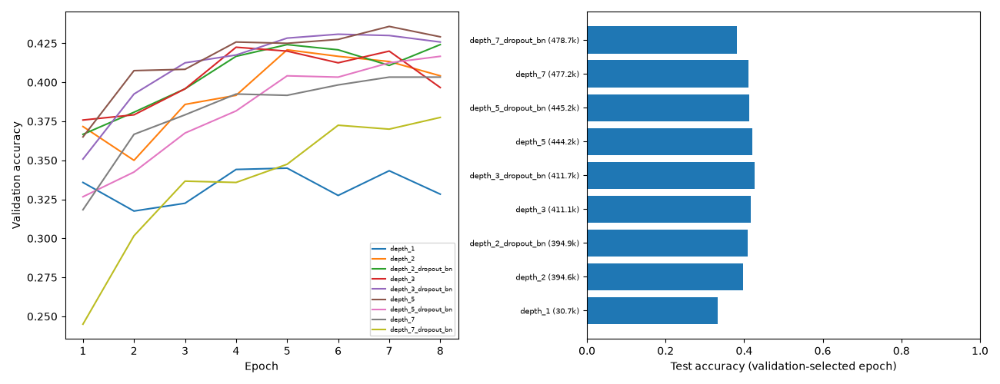
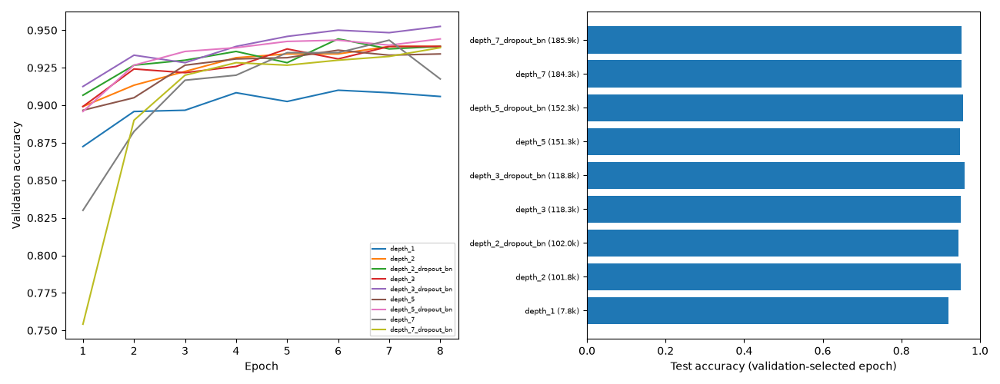
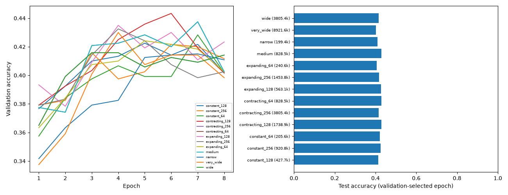
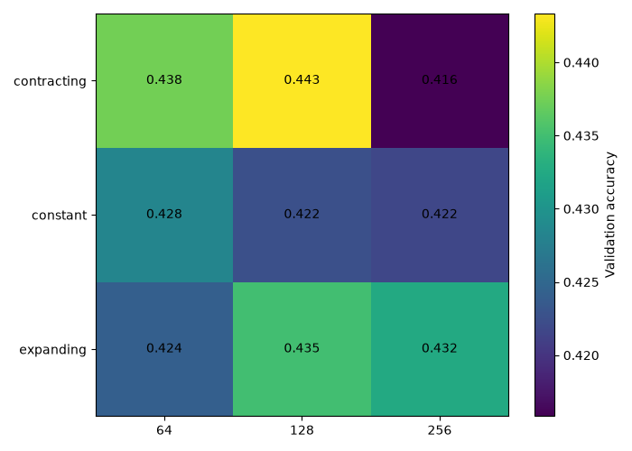
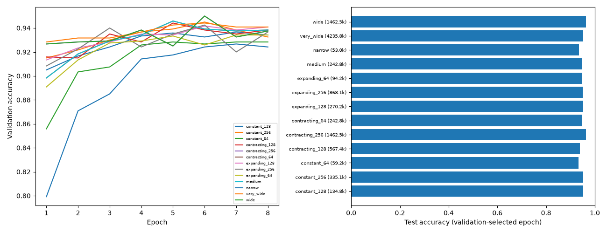
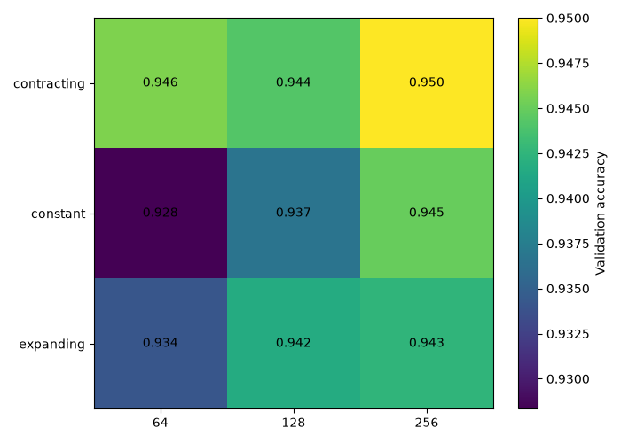
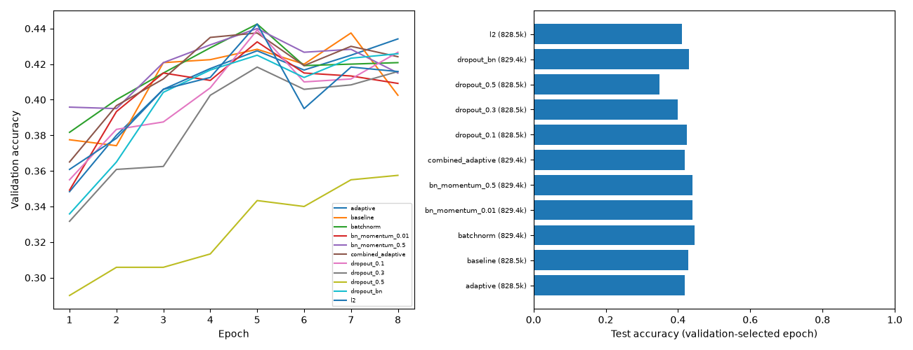
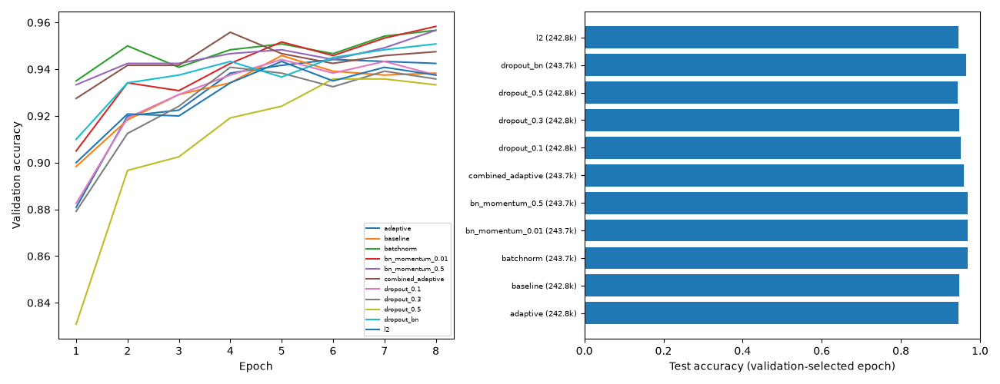

# Отчёт: полносвязные сети

## Задание и цель работы
Исследовать влияние глубины, ширины и регуляризации на классификацию MNIST и CIFAR-10. Выполнены задания 1–3 из HOMEWORK.md.

## Использованные методы
Использован FullyConnectedModel преподавателя: Linear, ReLU, Dropout, BatchNorm; CrossEntropyLoss и Adam. Глубина включает выходной Linear. В задании о ширине три заданных размера интерпретируются как три скрытых слоя плюс классификатор.

## Реализация
Отдельные программы в homework/; общий цикл в utils/experiment_utils.py. Сохраняются история, параметры запуска, число параметров, время обучения и инференса, нормы градиентов и контрольные точки. Dropout изменяется от 0.1 до 0.5 с меньшим коэффициентом на ранних слоях. Momentum BatchNorm: 0.01, 0.1, 0.5.

## Эксперименты
Случайное разбиение официальной train-части: 90% train, 10% validation, seed=42. Для опубликованного CPU-эксперимента взяты 6000 train, 1200 validation, 2000 случайных test-примеров; 8 эпох, batch_size=64, Adam lr=0.001. Это ограниченный эксперимент, не обучение на полном датасете. Полный запуск доступен без --train-limit и --test-limit.
Выбор эпохи и конфигурации производится по validation accuracy. Test не участвует в оптимизации или выборе. Train accuracy измеряется в eval-режиме. Время обучения включает backward и optimizer, но не оценку; инференс измеряется после прогрева. Результаты одного seed не являются оценкой статистической значимости.

## Результаты

### Глубина

| Данные | Модель | Параметры | Train, последняя | Val, лучшая | Test, выбранная | Секунды |
|---|---|---:|---:|---:|---:|---:|
| cifar10 | depth_1 | 30730 | 0.5012 | 0.3450 | 0.3335 | 2.60 |
| cifar10 | depth_2 | 394634 | 0.7558 | 0.4208 | 0.3965 | 5.00 |
| cifar10 | depth_2_dropout_bn | 394890 | 0.6030 | 0.4242 | 0.4095 | 7.63 |
| cifar10 | depth_3 | 411146 | 0.7867 | 0.4225 | 0.4160 | 5.53 |
| cifar10 | depth_3_dropout_bn | 411658 | 0.5825 | 0.4308 | 0.4260 | 6.55 |
| cifar10 | depth_5 | 444170 | 0.7080 | 0.4358 | 0.4205 | 6.59 |
| cifar10 | depth_5_dropout_bn | 445194 | 0.5068 | 0.4167 | 0.4120 | 10.55 |
| cifar10 | depth_7 | 477194 | 0.6237 | 0.4033 | 0.4105 | 7.12 |
| cifar10 | depth_7_dropout_bn | 478730 | 0.4502 | 0.3775 | 0.3810 | 11.30 |
| mnist | depth_1 | 7850 | 0.9290 | 0.9100 | 0.9195 | 3.07 |
| mnist | depth_2 | 101770 | 0.9903 | 0.9392 | 0.9520 | 5.83 |
| mnist | depth_2_dropout_bn | 102026 | 0.9875 | 0.9442 | 0.9450 | 4.41 |
| mnist | depth_3 | 118282 | 0.9883 | 0.9392 | 0.9520 | 4.70 |
| mnist | depth_3_dropout_bn | 118794 | 0.9895 | 0.9525 | 0.9600 | 6.63 |
| mnist | depth_5 | 151306 | 0.9838 | 0.9367 | 0.9485 | 6.82 |
| mnist | depth_5_dropout_bn | 152330 | 0.9810 | 0.9442 | 0.9565 | 9.51 |
| mnist | depth_7 | 184330 | 0.9618 | 0.9433 | 0.9530 | 7.94 |
| mnist | depth_7_dropout_bn | 185866 | 0.9692 | 0.9383 | 0.9540 | 12.96 |

Для cifar10 лучшая по validation конфигурация — **depth_5**: val=0.4358, test=0.4205. Разрыв train−test последней эпохи: 0.2855. Первый сигнал переобучения (train loss падает, val loss растёт): 4. Стандартное отклонение val accuracy по эпохам: 0.0212.

Без регуляризации оптимальная исследованная глубина: depth_5; val=0.4358. Сравнение пар:

| Глубина | Δ val (Dropout+BN − baseline) | Разрыв train−test baseline | Разрыв train−test Dropout+BN |
|---|---:|---:|---:|
| depth_2 | +0.0033 | 0.3378 | 0.1750 |
| depth_3 | +0.0083 | 0.3797 | 0.1555 |
| depth_5 | -0.0192 | 0.2855 | 0.0948 |
| depth_7 | -0.0258 | 0.2082 | 0.0692 |

Для mnist лучшая по validation конфигурация — **depth_3_dropout_bn**: val=0.9525, test=0.9600. Разрыв train−test последней эпохи: 0.0295. Первый сигнал переобучения (train loss падает, val loss растёт): 7. Стандартное отклонение val accuracy по эпохам: 0.0127.

Без регуляризации оптимальная исследованная глубина: depth_7; val=0.9433. Сравнение пар:

| Глубина | Δ val (Dropout+BN − baseline) | Разрыв train−test baseline | Разрыв train−test Dropout+BN |
|---|---:|---:|---:|
| depth_2 | +0.0050 | 0.0423 | 0.0395 |
| depth_3 | +0.0133 | 0.0418 | 0.0295 |
| depth_5 | +0.0075 | 0.0353 | 0.0245 |
| depth_7 | -0.0050 | 0.0363 | 0.0152 |

### Ширина

| Данные | Модель | Параметры | Train, последняя | Val, лучшая | Test, выбранная | Секунды |
|---|---|---:|---:|---:|---:|---:|
| cifar10 | constant_128 | 427658 | 0.7298 | 0.4225 | 0.4145 | 6.00 |
| cifar10 | constant_256 | 920842 | 0.7820 | 0.4217 | 0.4250 | 8.40 |
| cifar10 | constant_64 | 205642 | 0.6867 | 0.4283 | 0.4210 | 4.76 |
| cifar10 | contracting_128 | 1738890 | 0.7718 | 0.4433 | 0.4295 | 16.17 |
| cifar10 | contracting_256 | 3805450 | 0.7513 | 0.4158 | 0.4160 | 33.74 |
| cifar10 | contracting_64 | 828490 | 0.7522 | 0.4375 | 0.4280 | 8.05 |
| cifar10 | expanding_128 | 563082 | 0.8122 | 0.4350 | 0.4270 | 8.55 |
| cifar10 | expanding_256 | 1453834 | 0.8048 | 0.4325 | 0.4165 | 13.55 |
| cifar10 | expanding_64 | 240586 | 0.7285 | 0.4242 | 0.4065 | 4.73 |
| cifar10 | medium | 828490 | 0.7522 | 0.4375 | 0.4280 | 7.97 |
| cifar10 | narrow | 199450 | 0.6228 | 0.4150 | 0.4090 | 4.31 |
| cifar10 | very_wide | 8921610 | 0.6922 | 0.4300 | 0.4030 | 69.54 |
| cifar10 | wide | 3805450 | 0.7513 | 0.4158 | 0.4160 | 29.30 |
| mnist | constant_128 | 134794 | 0.9850 | 0.9367 | 0.9520 | 6.07 |
| mnist | constant_256 | 335114 | 0.9840 | 0.9450 | 0.9515 | 7.73 |
| mnist | constant_64 | 59210 | 0.9732 | 0.9283 | 0.9330 | 5.01 |
| mnist | contracting_128 | 567434 | 0.9947 | 0.9442 | 0.9390 | 8.98 |
| mnist | contracting_256 | 1462538 | 0.9857 | 0.9500 | 0.9645 | 16.50 |
| mnist | contracting_64 | 242762 | 0.9872 | 0.9458 | 0.9470 | 6.19 |
| mnist | expanding_128 | 270218 | 0.9912 | 0.9417 | 0.9515 | 8.61 |
| mnist | expanding_256 | 868106 | 0.9862 | 0.9425 | 0.9510 | 14.06 |
| mnist | expanding_64 | 94154 | 0.9797 | 0.9342 | 0.9490 | 5.48 |
| mnist | medium | 242762 | 0.9872 | 0.9458 | 0.9470 | 6.14 |
| mnist | narrow | 53018 | 0.9560 | 0.9267 | 0.9345 | 5.06 |
| mnist | very_wide | 4235786 | 0.9840 | 0.9442 | 0.9525 | 46.08 |
| mnist | wide | 1462538 | 0.9857 | 0.9500 | 0.9645 | 16.39 |

Для cifar10 лучшая по validation конфигурация — **contracting_128**: val=0.4433, test=0.4295. Разрыв train−test последней эпохи: 0.3483. Первый сигнал переобучения (train loss падает, val loss растёт): 4. Стандартное отклонение val accuracy по эпохам: 0.0206.

Для mnist лучшая по validation конфигурация — **contracting_256**: val=0.9500, test=0.9645. Разрыв train−test последней эпохи: 0.0327. Первый сигнал переобучения (train loss падает, val loss растёт): 4. Стандартное отклонение val accuracy по эпохам: 0.0077.

### Регуляризация

| Данные | Модель | Параметры | Train, последняя | Val, лучшая | Test, выбранная | Секунды |
|---|---|---:|---:|---:|---:|---:|
| cifar10 | adaptive | 828490 | 0.5778 | 0.4342 | 0.4195 | 11.38 |
| cifar10 | baseline | 828490 | 0.7522 | 0.4375 | 0.4280 | 9.68 |
| cifar10 | batchnorm | 829386 | 0.7572 | 0.4425 | 0.4460 | 8.88 |
| cifar10 | bn_momentum_0.01 | 829386 | 0.7510 | 0.4325 | 0.4410 | 10.32 |
| cifar10 | bn_momentum_0.5 | 829386 | 0.7603 | 0.4400 | 0.4405 | 10.10 |
| cifar10 | combined_adaptive | 829386 | 0.5730 | 0.4375 | 0.4180 | 10.99 |
| cifar10 | dropout_0.1 | 828490 | 0.6690 | 0.4392 | 0.4250 | 13.01 |
| cifar10 | dropout_0.3 | 828490 | 0.5218 | 0.4183 | 0.3985 | 9.53 |
| cifar10 | dropout_0.5 | 828490 | 0.4050 | 0.3575 | 0.3490 | 9.60 |
| cifar10 | dropout_bn | 829386 | 0.5613 | 0.4258 | 0.4305 | 10.23 |
| cifar10 | l2 | 828490 | 0.6907 | 0.4425 | 0.4115 | 10.86 |
| mnist | adaptive | 242762 | 0.9848 | 0.9442 | 0.9460 | 8.34 |
| mnist | baseline | 242762 | 0.9872 | 0.9458 | 0.9470 | 7.22 |
| mnist | batchnorm | 243658 | 0.9995 | 0.9567 | 0.9690 | 9.85 |
| mnist | bn_momentum_0.01 | 243658 | 0.9995 | 0.9583 | 0.9685 | 9.43 |
| mnist | bn_momentum_0.5 | 243658 | 0.9975 | 0.9567 | 0.9680 | 9.63 |
| mnist | combined_adaptive | 243658 | 0.9938 | 0.9558 | 0.9585 | 10.98 |
| mnist | dropout_0.1 | 242762 | 0.9862 | 0.9442 | 0.9510 | 7.54 |
| mnist | dropout_0.3 | 242762 | 0.9763 | 0.9408 | 0.9480 | 7.64 |
| mnist | dropout_0.5 | 242762 | 0.9605 | 0.9358 | 0.9435 | 7.75 |
| mnist | dropout_bn | 243658 | 0.9930 | 0.9508 | 0.9650 | 10.13 |
| mnist | l2 | 242762 | 0.9865 | 0.9433 | 0.9450 | 7.07 |

Для cifar10 лучшая по validation конфигурация — **batchnorm**: val=0.4425, test=0.4460. Разрыв train−test последней эпохи: 0.3057. Первый сигнал переобучения (train loss падает, val loss растёт): 6. Стандартное отклонение val accuracy по эпохам: 0.0172.

| Метод | Δ test к baseline | Std val accuracy по эпохам | Первый сигнал переобучения |
|---|---:|---:|---|
| adaptive | -0.0085 | 0.0271 | None |
| baseline | +0.0000 | 0.0220 | 2 |
| batchnorm | +0.0180 | 0.0172 | 6 |
| bn_momentum_0.01 | +0.0130 | 0.0233 | 4 |
| bn_momentum_0.5 | +0.0125 | 0.0152 | 6 |
| combined_adaptive | -0.0100 | 0.0226 | 6 |
| dropout_0.1 | -0.0030 | 0.0248 | 6 |
| dropout_0.3 | -0.0295 | 0.0300 | 8 |
| dropout_0.5 | -0.0790 | 0.0240 | None |
| dropout_bn | +0.0025 | 0.0309 | 6 |
| l2 | -0.0165 | 0.0237 | 6 |

Для mnist лучшая по validation конфигурация — **bn_momentum_0.01**: val=0.9583, test=0.9685. Разрыв train−test последней эпохи: 0.0310. Первый сигнал переобучения (train loss падает, val loss растёт): 6. Стандартное отклонение val accuracy по эпохам: 0.0159.

| Метод | Δ test к baseline | Std val accuracy по эпохам | Первый сигнал переобучения |
|---|---:|---:|---|
| adaptive | -0.0010 | 0.0203 | 7 |
| baseline | +0.0000 | 0.0142 | 6 |
| batchnorm | +0.0220 | 0.0066 | 6 |
| bn_momentum_0.01 | +0.0215 | 0.0159 | 6 |
| bn_momentum_0.5 | +0.0210 | 0.0063 | 5 |
| combined_adaptive | +0.0115 | 0.0075 | 5 |
| dropout_0.1 | +0.0040 | 0.0191 | 6 |
| dropout_0.3 | +0.0010 | 0.0196 | None |
| dropout_0.5 | -0.0035 | 0.0329 | 7 |
| dropout_bn | +0.0180 | 0.0120 | 6 |
| l2 | -0.0020 | 0.0136 | 7 |

#### Влияние на слои

Таблица использует веса лучшей validation-эпохи; нормы градиентов усреднены по обучению. Гистограммы weights.png показывают последнюю эпоху.

| Данные | Вариант | Слой | Std весов | Средняя норма градиента |
|---|---|---|---:|---:|
| cifar10 | adaptive | layers.0.weight | 0.03070 | 0.67158 |
| cifar10 | adaptive | layers.3.weight | 0.04619 | 1.58936 |
| cifar10 | adaptive | layers.6.weight | 0.05699 | 1.38301 |
| cifar10 | adaptive | layers.9.weight | 0.07229 | 1.53454 |
| cifar10 | baseline | layers.0.weight | 0.03119 | 0.68794 |
| cifar10 | baseline | layers.2.weight | 0.04772 | 1.50618 |
| cifar10 | baseline | layers.4.weight | 0.05938 | 1.61629 |
| cifar10 | baseline | layers.6.weight | 0.08209 | 1.95623 |
| cifar10 | combined_adaptive | layers.0.weight | 0.01622 | 0.87057 |
| cifar10 | combined_adaptive | layers.4.weight | 0.03936 | 1.14665 |
| cifar10 | combined_adaptive | layers.8.weight | 0.05279 | 0.82922 |
| cifar10 | combined_adaptive | layers.12.weight | 0.10245 | 0.77096 |
| mnist | adaptive | layers.0.weight | 0.03359 | 0.71716 |
| mnist | adaptive | layers.3.weight | 0.05089 | 0.65668 |
| mnist | adaptive | layers.6.weight | 0.06435 | 0.76961 |
| mnist | adaptive | layers.9.weight | 0.09901 | 0.99380 |
| mnist | baseline | layers.0.weight | 0.03154 | 0.52579 |
| mnist | baseline | layers.2.weight | 0.04726 | 0.60408 |
| mnist | baseline | layers.4.weight | 0.05811 | 0.91303 |
| mnist | baseline | layers.6.weight | 0.08799 | 1.24786 |
| mnist | combined_adaptive | layers.0.weight | 0.01967 | 1.18227 |
| mnist | combined_adaptive | layers.4.weight | 0.03737 | 0.71674 |
| mnist | combined_adaptive | layers.8.weight | 0.05072 | 0.45229 |
| mnist | combined_adaptive | layers.12.weight | 0.14802 | 0.33882 |

## Графики и таблицы
Сводные числовые данные: [summary.csv](homework/results/summary.csv). В каждом каталоге модели: curves.png (train/val/test loss и accuracy), weights.png (распределения весов по слоям), metrics.json (все исходные измерения).

## Выводы
Оптимальные конфигурации указаны отдельно для каждого датасета и группы выше, строго по validation. Большая глубина и ширина сами по себе не гарантируют улучшения; сравнение должно учитывать время, число параметров и разрыв train/test. Dropout и BatchNorm меняют динамику обучения, поэтому их эффект оценивается при одной базовой архитектуре [256,128,64].
Один рост validation loss — лишь ранний сигнал, а не доказательство устойчивого переобучения. Для окончательного выбора нужны повторения по нескольким seed и более длительное обучение на полном train. Синтетические тесты не используются в таблицах результатов.
